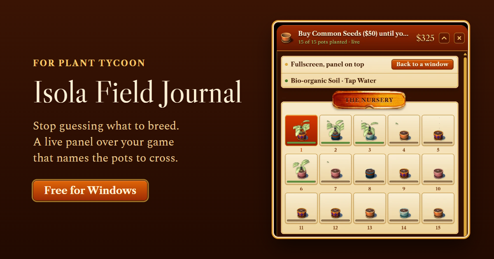
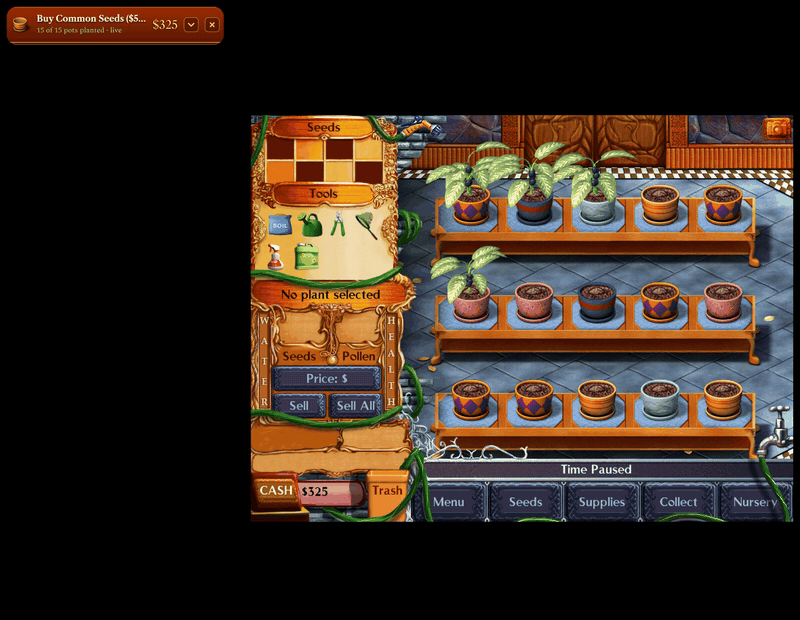
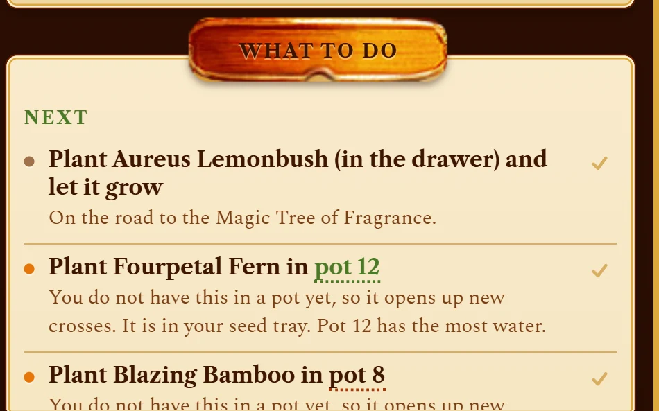
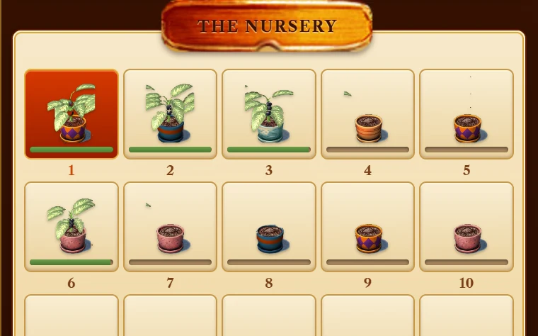

  

<h3 align="center">A free live companion for Plant Tycoon on Windows</h3>

  <a href="https://github.com/Kjubikstronk/isola-field-journal/releases/latest/download/IsolaFieldJournal-setup.exe"><b>Download for Windows</b></a> (1.3 MB)
  &nbsp;&middot;&nbsp;
  <a href="https://kjubikstronk.github.io/isola-field-journal/"><b>Website</b></a>
  &nbsp;&middot;&nbsp;
  <a href="https://kjubikstronk.github.io/isola-field-journal/calculator.html"><b>Breeding calculator</b></a>

  

Isola Field Journal sits on top of your game, reads your nursery as you play,
and tells you which pots to cross, what to plant next, and when no cross can get
you there. You need your own copy of
[Plant Tycoon on Steam](https://store.steampowered.com/app/16120/Plant_Tycoon/).

## What it does

<table>
  <tr>
    <td width="50%" valign="top">
      
      
<b>Names the pots.</b> "Plant the Fourpetal Fern in pot 12." "Cross pot 3 with pot 7." Real pot numbers you can act on, not a chart to decode.

    </td>
    <td width="50%" valign="top">
      
      
<b>Reads the game live.</b> Cash, all fifteen pots, water, health, growth and every seed in storage, five times a second. Nothing to export, nothing to type in.

    </td>
  </tr>
  <tr>
    <td width="50%" valign="top">
      
      
<b>Plans the road to a Magic Plant.</b> It picks the closest of the six, or the one you choose, and lists every purchase, planting and cross, ticking each off as it happens in your game.

    </td>
    <td width="50%" valign="top">
      
      
<b>Stays out of the way.</b> Folded, it is a slim bar over the game. <kbd>Ctrl</kbd>+<kbd>E</kbd> opens it without leaving the game.

    </td>
  </tr>
</table>

## The one rule

Every seed is the **average** of its two parents, rounded up: leaves and
flowers each on their own. Jalapa Bamboo &times; Fragrant Fanleaf: flowers 9 and
11 make 10 (Fabled), leaves 12 and 10 make 11 (Lemonbush), so the seed is a
Fabled Lemonbush, one of the six Magic Plants.

So **no cross can ever beat your best plant**. If you have crossed your two
best plants for an hour and nothing new turns up, that is arithmetic, not bad
luck. The journal knows this rule and tells you the moment you hit the ceiling.
Try it without installing anything in the
[breeding calculator](https://kjubikstronk.github.io/isola-field-journal/calculator.html).

## Install

1. [Download the installer](https://github.com/Kjubikstronk/isola-field-journal/releases/latest/download/IsolaFieldJournal-setup.exe)
   and run it. Windows may say "Windows protected your PC" because the app is
   not code-signed: click **More info**, then **Run anyway**.
2. Open Isola Field Journal and click **Launch Plant Tycoon**. The game opens
   fullscreen with the panel on top.
3. Play. <kbd>Ctrl</kbd>+<kbd>E</kbd> opens or folds the panel.

## Is it safe?

- **It only reads.** It never writes to the game or to your saves.
- **It never goes online.** No account, no ads, no tracking, no update checks.
- **It contains nothing from the game.** The pictures in the panel are read
  from your own installation.

Each release lists the installer's SHA-256 checksum, so you can check that your
download is exactly the published file.

## About this repository

This repository holds the website and the installers on the
[Releases](https://github.com/Kjubikstronk/isola-field-journal/releases) page.
Questions, ideas and problems are welcome as
[issues](https://github.com/Kjubikstronk/isola-field-journal/issues).

Isola Field Journal is an unofficial fan project. Plant Tycoon is a trademark of
Last Day of Work, who are not involved and do not endorse it.
